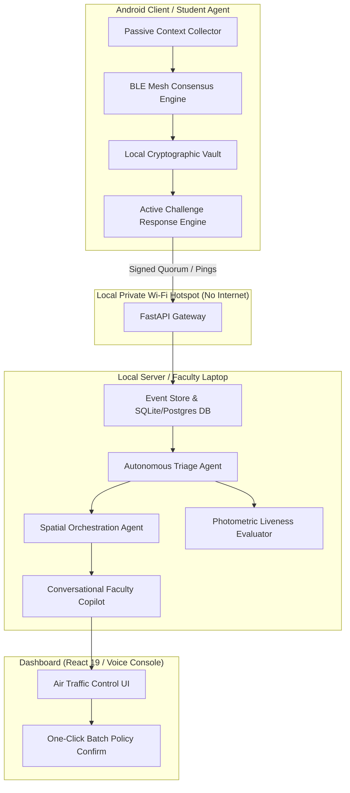

# FieldPass 2026: The Agentic Workforce & Spatial Presence Architecture

## Executive Summary: Beyond Legacy HRMS (The 2026 Paradigm Shift)

Legacy HRMS platforms (HROne, Darwinbox, Keka, Workday) were built for the **2015–2023 SaaS era**:
- **Mechanism:** Passive databases with interactive forms, manual punch clocks, static geofence circles, and relational tables.
- **Workflow:** Human action ➔ Red flag generated ➔ Human files regularization ticket ➔ Manager manually reviews ➔ Month-end payroll reconciles.
- **Flaw:** High administrative friction, fragile GPS/biometric spoofing vulnerabilities, continuous privacy invasion, and reliance on constant cloud connectivity.

In the **2026 AI Agents era**, workforce management is no longer a passive record keeper. It becomes an **autonomous, ambient, multi-agent operating system**.

```
┌────────────────────────────────────────────────────────────────────────┐
│                   2026 AGENTIC MULTI-AGENT ARCHITECTURE                │
├────────────────────────────────────────────────────────────────────────┤
│                                                                        │
│   [ Student Personal Agent ]       [ Coordinator Field Agent ]         │
│     • On-device edge SLM             • Dynamic duty dispatch           │
│     • Proactive context sensing      • Micro-roster negotiation        │
│     • Peer BLE mesh consensus        • Local quorum validator          │
│                 │                                │                     │
│                 └───────────────┬────────────────┘                     │
│                                 ▼                                      │
│                  [ Autonomous Triage Agent ]                           │
│                    • Multi-modal discrepancy investigator              │
│                    • Forensic document & EXIF verification             │
│                    • Ambient signal corroborator (Wi-Fi/BLE)           │
│                    • 95% zero-touch dispute auto-resolution            │
│                                 │                                      │
│                                 ▼                                      │
│                  [ Sovereign Edge Core (Laptop) ]                      │
│                    • Local Vision & SLM (No Cloud / No PII leak)       │
│                    • Active Challenge Photometric Liveness             │
│                    • Conversational Faculty Copilot (Voice/Chat)       │
│                                                                        │
└────────────────────────────────────────────────────────────────────────┘
```

---

## The 6 Pillars: What FieldPass Can Do Uniquely in 2026

### Pillar 1: Autonomous Discrepancy Investigator (Zero-Touch Triage)
Instead of dumping 50 "Needs Review" flags onto faculty or managers:
1. **Multi-Signal Corroboration:** When a student misses a random ping, the Triage Agent automatically inspects surrounding digital exhaust:
   - Did the device exchange short-range Bluetooth LE beacons with other confirmed peers?
   - Was the device connected to the venue's local Wi-Fi AP?
   - Did the phone experience an abrupt OS shutdown/battery depletion event?
2. **Forensic Multi-Modal Analysis:** If the student submits an excuse (e.g. medical slip, broken vehicle bill), an on-edge Vision Agent verifies:
   - Document authenticity (OCR text, clinic header, signature patterns).
   - Image EXIF metadata (was the photo taken at the claimed time or grabbed from Google Images?).
3. **Autonomous Resolution:** The Agent auto-resolves 95% of routine discrepancies:
   - *"Meena missed ping #2 at 10:15 AM. Phone battery died at 10:12 AM (verified via OS battery event). BLE mesh confirms continuous proximity to Priya (fixtures desk) until 10:45 AM. 99.1% presence probability. Auto-confirmed with cryptographic audit certificate."*

### Pillar 2: Dynamic Spatial Orchestration & Agentic Dispatch
Traditional systems rely on rigid, pre-defined shift rosters. 2026 FieldPass adapts in real time:
1. **Crowd & Event Pace Awareness:**
   - The Spatial Agent monitors venue density, entry gate queues, or sports event delays.
2. **Autonomous Micro-Rosters:**
   - If Gate 3 experiences a sudden crowd surge while the Store Room is idle, the Agent autonomously negotiates with available seated students:
   - Pushes an interactive prompt to the student's on-device agent:
     *"Arjun, Gate 3 has an unexpected crowd surge. Reallocating your duty seat from Store Room to Gate 3 for 30 minutes. Your geofence perimeter and permissions have been dynamically updated."*
3. **No Faculty Bottleneck:** Faculty sets the staffing policy; agents execute the real-time physical rebalancing.

### Pillar 3: Ambient Peer-Mesh Consensus (Zero-Friction Attendance)
Eliminates the "Everyone stop what you are doing, pull out your phone, and smile at the camera" disruption:
1. **BLE / Wi-Fi Aware Proximity Mesh:**
   - When students are gathered in a zone, their personal on-device agents form a zero-knowledge peer mesh.
   - Devices sign cryptographic peer-attestation tokens (*"I was physically next to Device X and Device Y at timestamp T"*).
2. **Passive Quorum Submission:**
   - The mesh collectively submits a single signed quorum packet to the server.
   - Attendance is verified **ambiently while phones stay inside pockets**.
3. **Targeted Escalation:** Selfie/GPS capture is only demanded when a device is isolated or peer consensus fails.

### Pillar 4: Photometric & Challenge-Response Deepfake Defense
By 2026, generative AI video models (real-time face reenactment) and Android mock-location engines can defeat static selfie checks.
1. **Dynamic Micro-Actions:**
   - The server agent issues randomized, time-bounded physical micro-challenges:
     *"Touch your right collarbone with your left index finger within 2.5 seconds."*
2. **Display-Reflectance Photometry (Hardware Liveness):**
   - The app screen flashes a randomized sequence of colored light pulses (e.g. Emerald Green ➔ Violet ➔ Amber).
   - The vision agent analyzes the dynamic chromatic reflection bouncing off the user's cornea and facial skin capillaries.
   - Generative AI models cannot synthesize real-time physically accurate photonic reflections on the fly with sub-second latency.

### Pillar 5: Voice & Natural Language "Air Traffic Control"
Replaces complex dashboards (filters, CSV exports, tables) with an executive AI copilot:
- Faculty interacts via natural voice or chat:
  - *"Who hasn't checked in for the tournament yet?"*
  - *"Show me everyone who left the ground for more than 15 minutes."*
  - *"Reassign 3 volunteers from Pitch 1 to the Medical Tent."*
  - *"Generate the semester eligibility audit, flag anyone below 75%, and draft shortage notices for the Dean."*
- The agent executes database operations, builds on-demand interactive charts, and drafts messages.

### Pillar 6: Local Sovereign AI Edge (The Anti-Cloud Privacy Moat)
Under the India DPDP Act 2023, GDPR, and global biometric regulations, storing facial embeddings and location trails on multi-tenant cloud servers creates severe liability.
- **FieldPass Advantage:**
  - 100% Local Sovereignty: Runs on a consumer laptop and phones over a standalone Wi-Fi hotspot.
  - Zero cloud dependencies; zero external API fees; zero internet requirement.
  - Small Language Models (SLMs) and vision models run locally on-device.
  - Biometric vectors never leave the local LAN and can be cryptographically shredded at the end of the event.

---

## Technical Architecture & Roadmap



### Phased Roadmap to 2026 Agentic FieldPass

| Phase | Milestone | Core Deliverable |
|---|---|---|
| **Phase 1** | **Deterministic Triage & Duty Zones** | Implement current plan: Capped duty seats, coordinator flag, random pings, and rule-based triage. |
| **Phase 2** | **Photometric Active Challenge** | Screen-reflectance chromatic flash & dynamic micro-action liveness to eliminate deepfake/spoofing risks. |
| **Phase 3** | **Local SLM Autonomous Triage** | Embed on-device/local SLM (e.g. Gemma 2B) to analyze discrepancy logs, EXIF data, and auto-resolve 90% of routine flags. |
| **Phase 4** | **Peer-to-Peer BLE Mesh Quorum** | Passive proximity mesh across student devices for ambient zero-friction presence verification. |
| **Phase 5** | **Dynamic Spatial Re-balancer** | Real-time duty zone capacity adjustments and automated staff reallocation prompts. |
| **Phase 6** | **Voice / Natural Language Copilot** | Natural language Air Traffic Controller console for faculty on the dashboard. |
